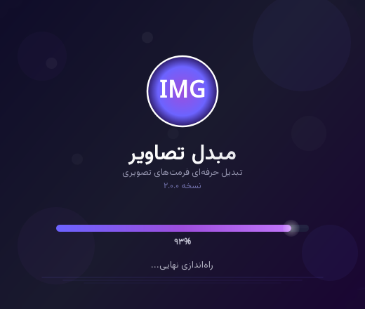
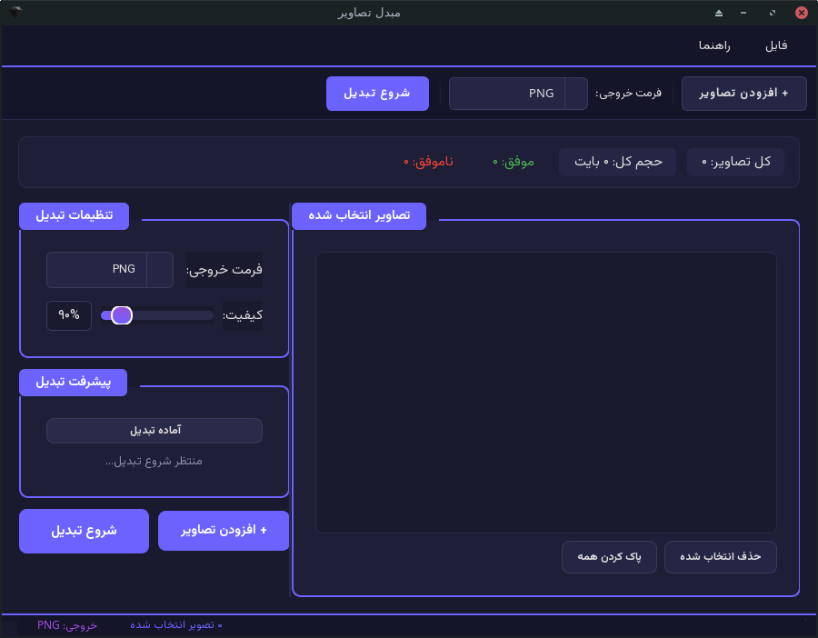

# 🎨 Image Converter - مبدل تصاویر

<div align="right">

یک ابزار دسکتاپ حرفه‌ای و زیبا برای تبدیل گروهی فرمت‌های تصویری با رابط کاربری فارسی و تم تیره

</div>

<p align="center">
  
</p>

---

## ✨ ویژگی‌ها

- 🖼️ **تبدیل گروهی تصاویر** - تبدیل چندین تصویر به صورت همزمان
- 🎯 **پشتیبانی از فرمت‌های محبوب** - PNG, JPG, JPEG, WEBP, BMP, GIF, TIFF
- 🎨 **تم تیره و مدرن** - طراحی زیبا با رنگ‌های بنفش و کنتراست بالا
- 🇮🇷 **رابط کاربری کاملاً فارسی** - راست‌چین شده با فونت وزیرمتن
- ⚡ **پیشرفت لحظه‌ای** - نمایش درصد پیشرفت حین تبدیل
- 📊 **گزارش کامل** - نمایش تعداد موفق و ناموفق بعد از تبدیل
- 🔧 **تنظیم کیفیت** - قابلیت تنظیم کیفیت خروجی برای JPG و WEBP
- 📁 **افزودن از پوشه** - امکان انتخاب کل پوشه‌های تصاویر
- 💫 **انیمیشن Splash Screen** - صفحه شروع زیبا با انیمیشن
- 🚀 **قابل حمل** - خروجی تک فایل EXE برای ویندوز
- 🎯 **بدون نیاز به نصب** - تمام پیش‌نیازها درون فایل اجرایی

---

## 📸 تصاویر برنامه

<div align="center">
  <table>
    <tr>
      <td><b>Splash Screen</b></td>
      <td><b>پنجره اصلی</b></td>
    </tr>
    <tr>
      <td></td>
      <td></td>
    </tr>
  </table>
</div>

---

## 🚀 نصب و اجرا

### پیش‌نیازها

- Python 3.8 یا بالاتر
- pip (مدیریت پکیج پایتون)

### نصب از سورس

```bash
# کلون کردن پروژه
git clone https://github.com/4uth0r/image-converter.git
cd image-converter

# نصب پیش‌نیازها
pip install -r requirements.txt

# اجرای برنامه
python main.py